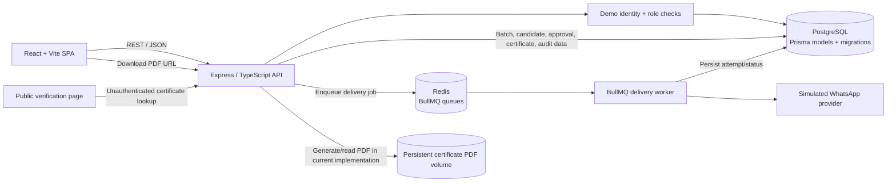

# CertiFlow Architecture

## Main data flow

1. A Training Centre submits a validated candidate roster. PostgreSQL commits the roster, batch status, and audit event atomically.
2. Approval requests transition the batch under optimistic version checks. Approval records are retained by review round; a correction creates a new round without erasing prior votes.
3. Final State approval persists certificate metadata and delivery records. PDF generation currently runs in the API process; delivery is queued asynchronously.
4. BullMQ workers invoke the simulated WhatsApp provider and update delivery status/attempts in PostgreSQL. Delivery jobs use stable IDs and provider idempotency keys.
5. Public verification reads the certificate status from PostgreSQL, so cancellation is visible immediately. Audit and overdue batch APIs are State Office restricted.

## Deployment boundary

The Compose stack is a single-host demo. The [deployment guide](DEPLOYMENT.md) describes the recommended stateless API, separately scaled workers, managed PostgreSQL/Redis, and private object storage for larger deployments. Those scale targets have not been load-tested.
