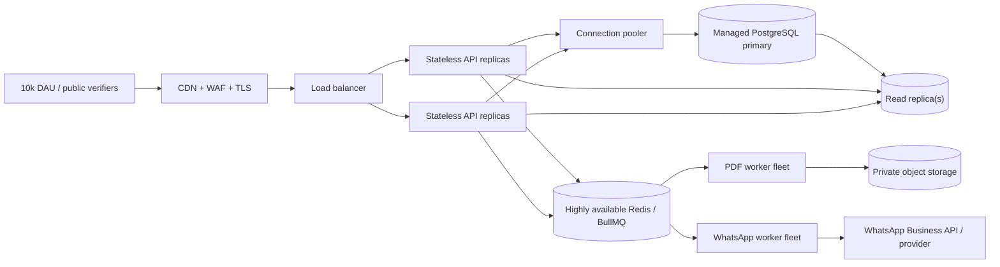

# Deployment and Scale Plan

This is a scale-out plan, not a measured capacity claim. The repository has not been load-tested at 100,000 users or 30,000 simultaneous jobs. The local Compose stack is intended for demos and development; see [SETUP.md](SETUP.md) for a fresh-clone run.

## Workload assumptions and targets

Plan for 100,000 registered users, 10,000 daily active users, and a peak issuance event of 30,000 PDFs plus 30,000 WhatsApp messages. The peak window is unspecified; for initial sizing, model 30,000 deliveries in one hour (about 8.3/sec average) and load-test burst rates above that. If the event is shorter, increase worker/provider throughput accordingly.

PDF size, verification read rates, message templates, provider limits, retries, and user request distribution need to be measured with representative data before committing to an SLA.

## Recommended production topology

### Horizontal scaling

- Keep API replicas stateless; put sessions, job state, and authoritative application data in shared managed services.
- Scale API replicas on request rate, CPU, memory, and p95/p99 latency behind a load balancer. Add rate limits and request-size limits at the edge.
- Separate PDF generation from API request handling before a 30,000-certificate event. In the current implementation, PDF generation is synchronous in the issuance request; it is a peak-load bottleneck.
- Scale PDF and delivery workers independently by queue depth, oldest-job age, worker utilization, and provider rate limits.
- Use a PostgreSQL connection pooler and bounded connection pools on every replica. Add read replicas for public verification and reporting after confirming replication lag is acceptable.

### Worker queues and backlog handling

- Use separate queues for PDF generation and external delivery, with bounded concurrency, retry policies, and stable idempotency keys.
- Alert on waiting/delayed/failed counts and oldest queued-job age. Starting alert thresholds (for tuning, not guarantees): backlog over 1,000 jobs or oldest job over 2 minutes.
- Autoscale workers against estimated drain time, not queue length alone. Limit scale-out to the database's connection budget and WhatsApp provider throughput.
- Apply provider rate limiting and exponential backoff with jitter. Avoid retry storms by pausing or circuit-breaking an unhealthy provider.
- Preserve job IDs and certificate/delivery metadata in PostgreSQL so jobs can be reconciled or re-enqueued safely. Jobs are at-least-once; exactly-once delivery cannot be guaranteed across an external provider boundary.

### Worker crashes

BullMQ locks and stalled-job handling allow eligible jobs to be reclaimed after a worker disappears. Use idempotent handlers so a job replay repairs state instead of creating another certificate or successful send. Set graceful shutdown/drain periods, monitor stalled and repeatedly failed jobs, and retain a dead-letter/manual-review path for exhausted retries. Verify these behaviors under forced process termination before production.

### Redis restart or failover

Use managed HA Redis with persistence appropriate to the recovery objective, TLS/authentication, memory alarms, and tested failover. BullMQ workers reconnect and Redis-backed jobs survive only to the extent guaranteed by the chosen persistence/failover configuration. Treat PostgreSQL as the source of truth and reconcile queued/failed delivery records after Redis recovery. The demo Compose Redis volume is not a high-availability guarantee.

### WhatsApp outage

The demo provider is simulated. The current BullMQ flow retries transient failures four times with exponential backoff and exposes failed delivery for State Office retry. For a real provider:

- Respect provider templates, consent, throughput limits, and error classifications.
- Add jitter/circuit breaking and provider status monitoring; don't hot-loop during an outage.
- Alert on failure rate, exhausted retries, and oldest undelivered certificate.
- Keep the certificate valid independently of message delivery; resume backlog after recovery and use provider idempotency keys where supported.
- Budget external message fees separately; pricing varies by country, template, and provider.

### Slow database

- Monitor pool saturation, connection wait time, query p95/p99, lock waits, deadlocks, storage/IOPS, replication lag, and slow-query samples.
- Set pool limits/timeouts per API and worker replica; add a pooler before increasing replica count.
- Keep transactions short. Avoid generating PDFs or calling external services inside a database transaction.
- Index measured high-volume access paths, archive/partition audit and delivery history as they grow, and add read replicas for read-heavy public lookup.
- Apply migrations through a pre-deployment step with backups and backward-compatible expand/migrate/contract changes. Do not use `prisma db push` against production.

### Certificate file storage and access control

Compose stores PDFs in a named local volume mounted at `/app/storage/certificates`; this survives container recreation on that host but is not shared across replicas. For production, move files to private S3-compatible/object storage with encryption, versioning, lifecycle/backup policies, and least-privilege worker credentials. Serve downloads through an authenticated API or short-lived signed URLs. Public verification should disclose only minimal status/details, never expose object keys or personal data, and reflect revocation immediately.

The current download route is public and the certificate registry/list route exposes more data than public verification. Restrict both before production; filesystem volume permissions alone do not provide per-user access control.

### Monitoring and alerting

Instrument API request volume/latency/error rate, auth denials, approval conflicts, database pool/slow queries, Redis health/memory, queue depth/age/stalled jobs, PDF generation time/failures, delivery attempts/success/failure, and storage usage. Use centralized structured logs with correlation IDs and redact candidate identifiers and credentials. Alert on:

- API availability and p95/p99 latency/error budgets.
- Database and Redis availability, saturation, and failover.
- Oldest BullMQ job, stalled jobs, and growing failed-job count.
- PDF creation failures and disk/object-storage capacity.
- WhatsApp provider errors, rate-limit responses, and delivery backlog.
- Audit ingestion failures and overdue review batches.

The `/api/health` endpoint exposes API/database/Redis component status. Add production-grade metrics, tracing, dashboards, and paging integration; these are not bundled in the demo.

## Rough monthly cost and trade-offs

Illustrative USD range for a modest managed deployment in one cloud region with HA PostgreSQL/Redis, two small API tasks, a small autoscaled worker pool, load balancing, logs, and moderate storage/egress:

| Component | Rough monthly range |
|---|---:|
| API replicas and load balancer | $100–$300 |
| PDF/delivery workers | $100–$350 |
| Managed PostgreSQL with HA/backups | $200–$600 |
| Managed Redis with HA | $100–$300 |
| Object storage, CDN, logs, monitoring, network | $100–$400 |
| **Planning total before messaging fees** | **about $600–$1,950/month** |

These are order-of-magnitude planning figures, not a vendor quote; region, instance sizes, HA topology, discounts, logs, data transfer, and support plans can change them substantially. If 30,000 PDFs average 200 KB, that event creates roughly 6 GB of PDF objects before replicas/versions and backups. Estimate WhatsApp separately as `message count × applicable per-message/provider price`; it may be a material variable cost. Confirm current provider terms and cloud calculator prices before submission or launch.

A single-node demo is much cheaper and simpler but has shared failure domains, limited throughput, and host-bound files. Managed HA services and separate worker pools cost more but improve recovery, scaling, and operational visibility. Reduce costs with autoscaling/scale-to-zero where acceptable, lifecycle policies, and bounded log retention; don't remove backups, audit retention, or queue durability without an explicit recovery trade-off.

## Release checklist

1. Change all demo passwords, database credentials, and application secrets; replace the demo identity-header scheme with real authentication.
2. Restrict certificate registry and download endpoints; use private object storage and signed access.
3. Configure managed PostgreSQL/Redis, backups, TLS, alerting, and provider credentials.
4. Run `prisma migrate deploy` as a controlled deployment step.
5. Load-test representative 30,000-job events and validate queue drain time, provider limits, DB headroom, and recovery after worker/Redis failure.
6. Confirm retention, privacy, consent, and legal requirements for candidate data and notifications.
